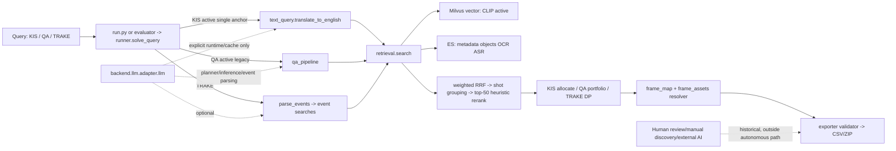

# PROJECT CONTEXT FOR REVIEW — HCMAIC 2026

**Ngày handoff:** 12/09/2026 · **Phạm vi:** context export chỉ-đọc · **Repo tại lúc quan sát:** `C:\dev\aic2026` · **Không phải báo cáo v2, baseline accuracy hay release approval.**

## 1. Project goal

### A. Mục tiêu tại thời điểm thi

AI Challenge HCMC 2026 sơ tuyển yêu cầu truy xuất khoảnh khắc video và nộp tối đa 100 CSV rows/query. KIS cần đúng `video_id` và absolute `frame_id`; Q&A còn phải đúng answer; TRAKE cần đúng một video và chuỗi N frame theo thứ tự event. `docs/contest.md` là nguồn luật format/scoring.

Hệ thống nhận query tiếng Việt, tìm candidate đa phương thức, map `keyframe_id` sang absolute frame bằng `frame_map`, rồi xuất CSV/ZIP đã validator. KIS chia slot để phủ shot/frame; Q&A tìm evidence rồi suy luận; TRAKE tìm từng event và chọn chuỗi tăng bằng DP.

### B. Mục tiêu engineering sau sơ tuyển

Mục tiêu hiện tại là làm hệ thống **đo được, tái lập được và ít phụ thuộc vào thao tác người hơn**: khóa identity code/config/data/index/model/cache; chặn resume/cache/provider sai; ghi trace đúng đường production; và xây GT độc lập có người xác minh. Không có claim rằng baseline accuracy mới đã được đo hay được promotion.

### C. Mục tiêu report v2

Report v2, nếu được tạo sau này, phải kể chuỗi: failure thi đấu → chẩn đoán có đo lường → cải tiến hậu sơ tuyển → evaluation có kiểm soát → hệ thống tự chủ/tái lập hơn. Nó không được viết lại lịch sử cuộc thi, biến score workflow thành score engine, hay gọi cải tiến sau này là capability đã có trong một submission cũ. **Report v2 chưa tồn tại.**

## 2. Competition history

| Đợt | Ngày | Final team-reported score | Diễn giải hợp lệ |
|---|---|---:|---|
| 1 | 21/08/2026 | **8.6/13** | Final competition workflow |
| 2 | 28/08/2026 | **13.6/15** | Final competition workflow |
| 3 | 04/09/2026 | **11.8/17** | Final competition workflow |

Cả ba con số là kết quả workflow cuối do đội báo cáo: internal retrieval, human inspection/verification/reranking, manual candidate discovery ở một số query, và ChatGPT/Claude bên ngoài ở một số query. Evidence closure không cho phép quy score này thành benchmark autonomous, tính uplift human/ChatGPT/Claude, hoặc forensic reconstruction mới.

Attribution có bằng chứng là multi-label và không exhaustive: ít nhất một R2 case có manual override; ít nhất 11 R3 query có external-AI interaction; ít nhất một R3 q9 nối được external orchestration tới artifact final. Các sự kiện đó không cho phép suy tác nhân chịu trách nhiệm cho mọi answer hay correctness.

## 3. Current system architecture

| Task | Active call path | Disabled/not default/experimental |
|---|---|---|
| KIS | `runner.solve_query()` → `multi_anchor.plan_query()` returns single plan because `multi_anchor.ENABLED=False` → `text_query.translate_to_english()` → `search()` with KIS override → allocation → exporter. | Multi-anchor planner/outer RRF exists but disabled. SigLIP2 remains disabled. OCR probe is enabled only through `KIS_BRANCH_OVERRIDE`. `query_understanding.translate/expand` are available but not default single-anchor search path. Agentic VLM CLI reranker is diagnostic only. |
| Q&A | `qa_pipeline()` in `legacy` mode → planner/rules, common `search`, optional text fallback, evidence collection, legacy LLM inference, validated `QAHypothesis`, `allocate_qa_portfolio()` → exporter. | `two_stage` exists behind `QA_INFERENCE_MODE`; not promoted. QA multi-anchor helper exists but only if supplied anchors. Placeholder/refusal behavior is being tightened in uncommitted H02 work; do not call it released evidence. |
| TRAKE | `parse_events()` (LLM then heuristic fallback) → `trake_search()` for every event → per-video candidate grouping/ASR context bonus → DP enforcing increasing frames/min gap → alternative observed rows then padding/interpolation → exporter. | Interpolated/padded frames are fallback, not observed-event evidence. No multi-anchor route. |

`search()` activates five default sources: `vector`, `metadata`, `objects`, `ocr`, `asr`; branches isolate their own errors and may contribute empty results. Its current default then groups by shot, runs configured heuristic top-50 rerank, and applies video-diverse order only if video prior is enabled (it is not). Source score is weighted RRF, not a hard cosine threshold.

## 4. Important source map

| Concern | File | Important symbols | Role/status |
|---|---|---|---|
| Batch runner | `backend/tasks/runner.py` | `solve_query`, `QueryRun`, `runtime_manifest`, `runtime_fingerprint` | **ACTIVE** production route; unified KIS/QA/TRAKE trace. |
| CLI/checkpoint | `run.py` | `main`, `giai_mot_query`, `Checkpoint`, `_llm_runtime_errors` | **ACTIVE** release batch/checkpoint route. |
| Retrieval | `backend/retrieval/search.py` | `search`, `_search_core`, `_finalize`, `_rrf` | **ACTIVE** five-source weighted RRF/shot path. |
| Query translation | `backend/retrieval/text_query.py` | `translate_to_english` | **ACTIVE** KIS single-anchor translation. |
| Alternate understanding | `backend/retrieval/query_understanding.py` | `translate`, `expand`, `count_clip_tokens` | **OPTIONAL/NOT DEFAULT**. |
| Multi-anchor | `backend/retrieval/multi_anchor.py` | `plan_query`, `search_multi`, `QueryPlan` | **DISABLED** by config; code/test remains. |
| Rerank | `backend/retrieval/rerank_top50.py` | `rerank` | **ACTIVE** configured heuristic rerank. |
| Agentic VLM rerank | `backend/retrieval/agentic_reranker.py` | `VLMReranker` | **TEST/DIAGNOSTIC ONLY** CLI path, not `solve_query()`. |
| Q&A | `backend/tasks/qa.py` | `qa_pipeline`, `parse_question`, `collect_evidence`, `ask_llm`, `_infer_legacy`, `_infer_two_stage`, `QAHypothesis` | **ACTIVE legacy**; two-stage **OPTIONAL/not promoted**. |
| QA allocation | `backend/tasks/qa_portfolio.py` | `allocate_qa_portfolio` | **ACTIVE** candidate-specific portfolio. |
| TRAKE | `backend/tasks/trake.py` | `parse_events`, `_parse_events_llm`, `trake_search`, `_align_events_in_video`, `to_answers`, `pad_answers` | **ACTIVE**. |
| Mapping/assets | `backend/common/frame_assets.py`, `backend/indexing/frame_map.py` | `resolve_frame_path`, `load_frame_map` | **ACTIVE**; resolver prefers raw then derived; never infer frame from ordinal filename. |
| Slot allocation | `backend/slot/allocator.py` | `allocate`, `ShotHit`, `_allocate_trake` | **ACTIVE** KIS/legacy-QA allocation. |
| Export | `backend/export/exporter.py`, `data/config/submit_format.py` | `validate_submission`, `write_submissions`, `write_submission_zip`, `Answer` | **ACTIVE** structural/semantic validation and writing. |
| LLM adapter | `backend/llm/adapter.py` | `llm`, `selected_runtime`, `_cache_key`, `CacheOnlyMissError` | **ACTIVE single external-model gateway**. |
| Repro harness | `scripts/run_reproducible_baseline.py` | `execute_query`, `read_checkpoint`, `audit_mapping` | **H01 active infrastructure; no accepted live baseline**. |
| Preflight/selfcheck | `scripts/preflight_check.py`, `scripts/selfcheck.py` | `main`, `check_*` | **ACTIVE gates**; selfcheck remains incomplete for GT coverage. |
| Evaluator/scorer | `dev_set/tools/run_evaluation.py`, `dev_set/tools/scoring.py`, `dev_set/tools/scorer_contract.py` | `run_evaluation`, `runtime snapshot`, scorer digest | **ACTIVE tooling**, but old sets are consumed/non-independent. |
| Resource identity | `backend/common/resource_identity.py`, `data/config/experiment.py` | capture/hash routines, `RUNTIME_ENV_KEYS` | **H01 infrastructure**. |
| Cache | `data/cache/llm`, `data/cache/qa_hypotheses`; adapter/QA cache functions | `_cache_get/_put`, `_qa_cache_*` | **ACTIVE/guarded**; cache-only experiment is diagnostic. |

## 5. Current configuration

Values below distinguish code/config from process selection; no `.env` value is treated as operator intent and no secret is shown.

| Area | Current effective code/config value | Status/type |
|---|---|---|
| Vector | CLIP `ViT-B-32-quickgelu`, `openai`, 512 dimensions; L2 + COSINE; Milvus `keyframes` | **CONFIG FILE / active default**. `VECTOR_BACKEND` process env may select SigLIP2 but current documented H01 state is CLIP. |
| SigLIP2 | `ViT-SO400M-16-SigLIP2-256/webli`, 1152, collection `keyframes_siglip2` | **CONFIG EXISTS, disabled** (`VECTOR_BACKEND` default `clip`; KIS override false). |
| Search sources | vector T; metadata T; objects T; OCR T; ASR T; `vector_siglip2` F; `ocr_probe` F globally; `text_vi` F | **CONFIG FILE**. KIS override makes `ocr_probe=True`, keeps SigLIP2 false. |
| Fusion/pool | `RRF_K=7`; weights vector 1.0, objects 0.7, OCR 0.6, ASR 0.6, metadata 0.4, OCR-probe 1.0; default multiplier 5; KIS multiplier 15 (top-100 ⇒ 1,500/branch) | **CONFIG FILE / active as routed**. |
| Rerank/video prior | top-50 heuristic `ENABLED=True`, `TOP_N=50`; video prior `ENABLED=False`, alpha 0.5 dormant | **CONFIG FILE**. Agentic VLM top-50 is not the active reranker. |
| KIS multi-anchor | `ENABLED=False`, outer RRF K=7 | **DISABLED**. |
| Slot budget | `SLOT_BUDGET=[(50,2)]`, 100 rows | **CONFIG FILE / active**. This materially conflicts with `AGENTS.md`’s stale `[(1,2),(2,2),(94,1)]`. |
| Q&A | mode default `legacy`; legacy max tokens 2048; two-stage cap 42, cohort/screen max 768; text fallback enabled, quota 5, text-oriented routes | **CONFIG DEFAULT**. `QA_INFERENCE_MODE` is process env override and must be explicit for release. |
| Q&A policy | `semantic`, `exact`, `robust` variants exist; operational round-1 policy is `robust` | **OPERATOR-SELECTION REQUIRED**: release command must pass `--qa-submission-policy`. |
| TRAKE | event pool 1,000; candidates/event/video 20; min gap 30; order bonus 5.0; min blend 2.0; max videos 20; variants/video 5; padding shift 60 | **CONFIG FILE / active**. |
| Export | 100 rows/query, CSV UTF-8 no header, answer ≤100 characters, ZIP root directory `submission/` | **CONFIG/rules active**. |
| Environment | `LLM_BACKEND`, backend-specific model, `LLM_CACHE_ONLY`, `LLM_NO_CACHE`, `LLM_CACHE_DIR`, `QA_HYPOTHESIS_CACHE_DIR`, `VECTOR_BACKEND`, asset paths | **PROCESS ENV**. Backend/model selection is required; `.env` may fill only missing API secrets. |

## 6. Data and indexes

Raw BTC assets are source images/videos; derived parquet/index/cache are not substitutes for archive provenance. `keyframe_id` joins Milvus, ES and frame map. Raw ordinal images such as `0007.jpg` are not absolute frames; submission frame comes from `frame_map.parquet`.

| Dataset/index | Recorded current identity/count | Identity status |
|---|---:|---|
| Raw keyframes | 177,321 JPG in 873 video directories | offline content asset hash captured by H01; pixel parity historical 84/873 only. |
| `frame_map.parquet` | 177,321 rows/873 videos; SHA `37cc…ec22` | offline verified structure/hash; not universal pixel parity. |
| Derived `keyframes`/`clip_kf_map` | 371,702 rows each/873 videos | offline/historical derived count; not live-vector count. |
| Shots | 100,810/873 videos | offline manifest. |
| OCR | 160,393 rows/872 videos | offline manifest. |
| ASR | 13,415 segments/783 videos; 90 videos absent | offline manifest; clean provenance 9,210 Gemini, 4,205 fallback by historical meta. |
| ES | metadata 873, objects 177,321, OCR 160,393, ASR 13,415; ES 8.13.4 | H01 live read-only capture: UUID/mapping/content digest recorded. |
| Milvus | `keyframes`, 177,321 entities, HNSW/COSINE; collection ID `468480499968244985` | H01 live read-only capture/content digest recorded. |

H01 reports Docker recovered and containers healthy with named volumes `aic2026_es_data` and `aic2026_milvus_data`; no restore/reindex/delete was performed. The content digest is a read-only scan, not proof of a simultaneous historical snapshot or of the exact database state used by any competition ZIP. Identity labels therefore are: **live verified at H01 capture** for accessible DB schema/count/content; **offline verified** for hashed files/manifests; **historical only** for contest-runtime equivalence and 12-image CLIP parity; **unknown** for atomic past state, all untested pixel identity, and exact scoring-run resources.

## 7. LLM/VLM call paths

| Task/path | Function | Purpose | Selection | Cache-key inputs | Provider call? |
|---|---|---|---|---|---|
| KIS single translation | `text_query.translate_to_english` → `llm` | VI short caption → EN for vector | explicit adapter runtime | adapter prompt/schema/model/backend/n/effort/tokens/temp/image bytes | Yes, unless valid cache; cache-only miss raises. |
| Optional query understanding | `query_understanding.translate/expand` | translation/expansion | adapter | adapter key | Potentially; not default KIS route. |
| Multi-anchor planner | `multi_anchor.plan_query` | plan ≤3 faithful anchors | adapter | adapter key | Potentially, but disabled. |
| QA planner | `qa.parse_question` | identify event/question/evidence mode | adapter plus QA planner cache | question hash, LLM identity, prompt version, runtime fingerprint | Yes on cache miss unless cache-only. |
| QA legacy | `_infer_legacy`/`ask_llm` | answer from selected evidence | adapter plus evidence cache | full query/question, model/backend, prompt/config/runtime, evidence hash | Yes on miss unless cache-only. |
| QA two-stage | `_infer_two_stage` | screen/confirm candidates | same gateway/budget | same plus stage parameters | Potentially; optional/not promoted. |
| TRAKE parsing | `_parse_events_llm`/`parse_events` | turn query into event list | adapter then heuristic fallback | adapter key | May call; heuristic fallback may avoid provider. |

`LLM_BACKEND` must be exactly `api`, `gemini`, or `local`; it selects `LLM_API_MODEL`, `LLM_GEMINI_MODEL`, or `LLM_LOCAL_MODEL`. `LLM_API_KEY` in the request means the API credential conceptually; actual API path checks `ANTHROPIC_API_KEY`, and Gemini checks `GEMINI_API_KEY`. `LLM_CACHE_ONLY=1` allows a valid cache hit but blocks dispatch on any miss. `LLM_NO_CACHE=1` disables reads/writes, so it will also cause a cache-only miss. There is no automatic cross-provider fallback. Intended future live selection is **`LLM_BACKEND=api`, `LLM_API_MODEL=claude-sonnet-5`**; that model name is not an API key. H01 cache-only chose this runtime configuration but made zero provider calls.

## 8. Cache semantics

The adapter cache directory defaults to `data/cache/llm` (`LLM_CACHE_DIR` overrides it). Its SHA-256 key canonicalizes prompt, schema, selected backend/model, `n`, effort, max tokens, temperature, and SHA-256 of each image’s **bytes**. A valid hit returns cached output; corrupt adapter cache is treated as a miss. Normal mode may call the selected provider after a miss; `LLM_NO_CACHE` skips cache; `LLM_CACHE_ONLY=1` raises `CacheOnlyMissError` before dispatch and increments a miss counter.

Q&A additionally stores evidence/inference cache under `data/cache/qa_hypotheses` (override `QA_HYPOTHESIS_CACHE_DIR`). Its identity includes full-query/question hashes, LLM identity without secret, prompt/config snapshot, evidence digest, runtime fingerprint and schema version. Mismatch is fail-loud (`QAEvidenceCaptureError`), not an implicit re-call. Writes use temporary file/replace and per-key single-flight locking. `run.py`/evaluation resume rejects checkpoint records with a different runtime fingerprint; cache newly written during a run is also recorded/guarded.

H01 copied **913 historical Sonnet-5 metadata files** into an isolated work cache. The locked 30-query diagnostic (23 KIS, 5 QA, 2 TRAKE) produced **0 hits, 132 misses, 0 provider calls, $0**, because a matching model label does not match the full prompt/image/parameter key. Only five non-LLM-dependent queries exported; 25 were explicitly blocked. This is why “cache files exist” is not “the run is reproducible from cache.” The paired observer comparison found 30/30 semantic equality and 5/5 byte-identical CSV only for the current fallback/blocked diagnostic scope—not answer correctness or a complete replay.

## 9. Current Git/source state

At observation: branch `wip/codex-h01-20260912`, `HEAD=235414784b5ee80b9552fd7fe7ce898db1cbf35b` (also `origin/wip/codex-h01-20260912`). `8fee5fd07bfd03d945fe93d474ffe2c29a4b7106` is `main` and `codex/pp-h01-reproducibility`; it is an ancestor of HEAD. `2354147` follows `704bb09` and carries a WIP handoff commit. The H01 records explicitly say neither `704bb09` nor `2354147` may have its entire diff attributed to H01; both include unrelated pre-existing/report work.

The working tree is dirty: tracked changes include `backend/api/main.py`, exporter/QA/runner/config files, `run.py`, reproducibility/promotion tools and relevant tests; untracked items include `backend/common/qa_contract.py`, H01 cache-only artifacts, `reports/post_preliminary_h02_20260912/`, and `tests/test_h02_contract.py`. These are state to review, not evidence that H02 was authorized or completed. The earlier branch `codex/pp-h01-reproducibility` remains relevant as the 8fee5fd H01 base, but is not current HEAD.

Attribution boundaries: **H01A** is explicit runtime/dotenv/alpha validation; **H01B** is resource/runtime/index identity; **H01C** is production instrumentation/harness/resume; **cache-only extension** is adapter/harness block-on-miss, fingerprints and its diagnostic artifacts. Current uncommitted H02-oriented contract work is separate and must not be retroactively called H01.

## 10. H01 complete history

1. The 11/09 evidence audit froze `PP-B0-20260911` but found four H01 drivers: `.env` import side effect selecting runtime, invalid video-prior alpha checked after retrieval, incomplete runtime/index identity, and inadequate production instrumentation.
2. H01A made alpha validation pre-I/O; dotenv only supplies missing secrets; backend/model must be selected in process; missing/wrong selected runtime cannot become silent translation fallback.
3. H01B added source/config/function/prompt/data/model/dependency/scorer/cache identity, ES/Milvus schema/count/content capture, and guards against incomplete identity.
4. H01C added search/task/export/mapping trace, worker context, append/flush harness and fingerprint/cache-aware resume.
5. Tests and read-only Docker/DB recovery/capture followed. Initial H01 checkpoint: focused 122 pass + 43 pass; full 922 pass, 1 skip, 2 warnings; preflight 18 pass/1 fail/2 skip (runtime selection); selfcheck exit 1 due GT/runtime gaps.
6. Cache-only extension followed the explicit $0 decision. It produced red tests, then 44 focused green; full **928 passed, 1 skipped, 2 warnings (111.85 s)**; development and release preflight **19/0/2**. Selfcheck still exits 1 because holdout13 is only 6/13 verified and round1 has 0/25 GT.
7. Cache-only query diagnostic did not yield a complete baseline; reviewer approval is not asserted. Current decision is **APPROVED INFRASTRUCTURE / PERFORMANCE BASELINE NOT PROMOTED**. No H02–H05 performance work is approved by that result.

## 11. H01 current artifacts

| Artifact | Meaning | Classification |
|---|---|---|
| `reports/post_preliminary_h01_20260912/CHECKPOINT_H01.md` | first H01 status, initial test/preflight/gaps | **SUPPORTING EVIDENCE/HISTORICAL checkpoint**; superseded for cache-only state. |
| `.../live_api_sonnet5/CACHE_ONLY_CHECKPOINT.md` | latest H01 decision/results | **SOURCE OF TRUTH** for H01 final cache-only status. |
| `identity_delivery/runtime_manifest.json`, `resource_capture/runtime_manifest.json` | captured runtime/resource identity | **SUPPORTING EVIDENCE**, capture-only—not run baseline. |
| `asset_identity.json`, `index_content_identity.json`, `identity_summary.json` | raw assets/DB identity scan | **SUPPORTING EVIDENCE**. |
| `source_snapshot_manifest.json`, `source_cache_only_snapshot_manifest.json` and source ZIPs | immutable-ish file inventories/checksums | **SUPPORTING EVIDENCE**; source snapshot, not clean historical runtime. |
| `live_api_sonnet5/queries.json`, `queries.jsonl`, `cache_seed_manifest.json` | locked diagnostic input/cache inventory | **SOURCE OF TRUTH** for cache-only diagnostic scope. |
| `comparison.json`, `off_comparison_protocol.json` | on/off semantic/byte comparison | **DIAGNOSTIC ONLY**. |
| cache-only `*_command.json`, `*_delivery_verification.json`, logs | commands, test/preflight/selfcheck evidence | **SUPPORTING EVIDENCE**. |
| `instrumentation_fixture.json` | deterministic production-shaped fixture | **DIAGNOSTIC ONLY**. |
| `review.md`, `PLAN.md`, `README.md` | plan/review/history | **SUPPORTING/HISTORICAL**, not a promotion gate by itself. |

## 12. Evaluation data registry

| Category | Sets/counts | Provenance/verification/use policy |
|---|---|---|
| TRAIN/TUNING | `tune_kis` 23, `tune_qa` 5, `tune_trake` 2; generated QA/TRAKE sets 10/10 and 2/2; `synth_trake` 6 | consumed tuning; not independent; no full human verification. |
| DIAGNOSTIC | dress25 19 KIS/5 QA/1 TRAKE; `full_test` 4; holdout KIS/QA/TRAKE 36/27/29 (+29 single-window) | old “holdout” has been observed/tuned; non-independent and diagnostic only. |
| REGRESSION | `batch1_holdout13` 13, only 6 human verified | consumed regression, partial verification; may not make independent performance claims. |
| COMPETITION POSTMORTEM | `official_r1r2` 55 (and related score artifacts) | submission priors/assistant labels; not human GT and not independent. |
| VALIDATION | proposed 12 KIS/6 QA/4 TRAKE | **not created/not verified**. |
| SEALED HELD-OUT | proposed 12 KIS/6 QA/4 TRAKE | **not created/not viewed/sealed**. |

No previous file called “holdout” remains independent because its queries/GT/results were viewed and used to choose/tune earlier behavior. The registry source is `reports/post_preliminary_cycle_20260911/evaluation_registry.json`; it names no ready independent set.

## 13. Proposed new verified dataset

Planned corpus: **24 KIS, 12 QA, 8 TRAKE** for creation/tuning, with independent validation **12/6/4** and sealed held-out **12/6/4**. **Status: NOT CREATED.**

Before use, each GT needs human frame/video verification with versioned annotation schema and provenance. Sampling must prevent near-duplicate/video leakage across train, validation and sealed subsets. Sealing requires locking content/hash/access before any model/system output is viewed; no model output may drive labels. Existing materials do not demonstrate this procedure has begun.

## 14. Failure taxonomy

| Area | Observed failure | Likely cause | Unproven/not allowed inference |
|---|---|---|---|
| KIS | retrieval miss; low rank; correct video/wrong frame; fusion/shot/allocation uncertainty | weak/misaligned source signal, sparse keyframes, ranking and coverage tradeoff | a component caused a competition score loss. |
| Q&A | placeholder previously could appear as success; refusal/sentinel; insufficient evidence; unsupported answer; high latency | evidence/answer contract gaps, fallback semantics, costly image inference | fallback output is correct because task status says success. |
| TRAKE | interpolation versus observed evidence; event candidate gaps; DP/min-gap/localization issues | sparse candidates, event ambiguity, temporal constraints | an interpolated frame is visual evidence or a DP setting improves real score. |
| Runtime | runtime/model/config identity, index identity, cache replay, export/mapping | `.env` side effects, partial manifest/cache mismatch, historical provenance gaps | identical labels/counts prove identical historical run. |

Multi-anchor is a concrete measured diagnostic: 19 KIS fell 0.4000 → 0.3263 under true multi-anchor, then returned to 0.4000 after rollback. That is not an official-score comparison. H01 cache diagnostic proves fallback may conceal LLM failures (`task_success=30` while 25 output paths were blocked), not that 30 answers are valid.

## 15. PP-H02 / H03 / H04 / H05

| Hypothesis | Status | Problem/evidence | Proposed work, gate, rollback/dependency |
|---|---|---|---|
| H02 offline QA correctness contract | **APPROVED IN PRINCIPLE / not authorized as production completion** | placeholder/refusal/evidence semantics and stale replay | Pure contract with success/supported, needs-review, abstain, failed; zero provider calls; gate blocks placeholders/refusals export, preserves valid zero/negative/evidence; rollback if contract breaks replay/export. Depends on locked historical denominator and no H01 performance claim. |
| H03 | **NOT STARTED** | no post-H01 live baseline or new verified GT | Must be separately specified/preregistered after required gate; no inferred implementation. |
| H04 | **NOT STARTED** | same | No implementation/metrics/acceptance gate authorized. |
| H05 | **NOT STARTED** | same | No implementation/metrics/acceptance gate authorized. |

The `reports/post_preliminary_h02_20260912/PLAN.md` is a protocol/design artifact, not permission to silently promote dirty work or begin H03–H05. Do not infer authorization from prior prompts.

## 16. Current next decision

The pending decision is whether the operator authorizes the next bounded, offline H02 correctness-contract phase after reviewing its scope—or supplies matching evidence cache / explicitly budgets a live run to finish H01 baseline coverage. Current facts: H01 infrastructure accepted; cache-only performance baseline not promoted; paid API spend is not authorized; no H03–H05 work may begin automatically.

## 17. Known no-go rules

- Do not rewrite competition history or call final 8.6/13, 13.6/15, 11.8/17 autonomous benchmarks.
- Do not calculate human/ChatGPT/Claude uplift or treat output diffs as attribution.
- Do not treat consumed old sets as independent holdout, silently change denominator/GT, or use a final submission as independent GT.
- Do not auto-select backend/model from `.env`, switch provider, or spend API credit without explicit authorization.
- Do not modify historical ZIPs, Git history, cache evidence, GT, config or competition artifacts to make a result look cleaner.
- Do not call cache replay when full cache identity mismatches; do not call fallback correct merely because status is success.
- Do not infer frame from ordinal filename; use `frame_map` and `resolve_frame_path()`.
- Do not start another hypothesis before its stated STOP gate, identity/GT/evaluation prerequisites.

## 18. Report v1 and report v2

Report v1 is `reports/technical_report_draft_20260910/ThanhNghe_TechnicalReport.md` (with PDF cited by the baseline manifest). It claims a multimodal retrieval architecture, mapping/export infrastructure, evidence-aware QA/TRAKE paths, qualified diagnostic measurements, and the human/external-assistance boundary. It deliberately does **not** claim final scores are autonomous, all historical configurations are reconstructed, multi-anchor is successful, or branch-only fixes protected a particular submission.

Report v2 should demonstrate the later controlled engineering loop, not revise v1’s competition facts. It requires completed independent verification/evaluation and explicit approval before it exists.

## 19. Open questions and gaps

| Class | Open issue |
|---|---|
| BLOCKING NEXT IMPLEMENTATION | explicit operator scope/approval for H02; do not conflate uncommitted H02 files with authorization. |
| BLOCKING PERFORMANCE CLAIM | matched full evidence cache or approved funded baseline; independent human-verified validation/sealed GT; clean paired resource identity. |
| NON-BLOCKING | complete SigLIP2 identity collector before enabling it; atomic DB snapshot support; historical runtime wheels/model-weight capture. |
| HISTORICAL / NOT WORTH FURTHER FORENSICS unless new evidence appears | exact autonomous provenance of R1 6.8/R3 11.2, R2 4.4 purity, upload receipt/repack lineage, exhaustive assistance attribution. |

## 20. One-page executive handoff

**Current state.** Code routes all tasks through `runner.solve_query`; active KIS is single-anchor CLIP-plus-text retrieval, active Q&A is legacy evidence inference/portfolio, and active TRAKE is event search plus temporal DP. The repository is at WIP HEAD `2354147` with material tracked/untracked changes; it must be reviewed as a dirty source state.

**What is verified.** H01 added runtime/resource/trace/cache-only safeguards and documented read-only DB/content identity; latest full suite evidence is 928 passed, 1 skipped. Cache-only test/preflight has no provider calls. Frame mapping/export invariants are explicitly guarded.

**What is not verified.** No accepted 30-query live performance baseline exists; historical cache did not match 25/30 locked diagnostics; no independent verified validation or sealed held-out set exists; historical competition run provenance is incomplete.

**What changed.** H01A/B/C and cache-only safety/instrumentation changed infrastructure and observability, not retrieval quality. There is uncommitted H02-oriented code/artifact state that is not a completed authorization or performance claim.

**What has not changed.** Competition artifacts, GT, historical ZIPs, model/provider selection policy, and official-score interpretation remain immutable. Final scores remain human/operator/external-assistance workflow results.

**Experiment status.** Infrastructure is approved; performance baseline is not promoted. Cache-only observer on/off is semantically equal only within its limited diagnostic scope; it has zero verified cache hits and zero new external calls.

**Next approved action.** Seek an explicit operator decision on a bounded offline H02 contract review/implementation, or supply exact cache/evidence/approved budget for H01 coverage.

**Next forbidden action.** Do not call a paid provider, auto-switch provider/model, launch H03–H05, modify historical evidence, or publish report v2/performance uplift.

**Do not misunderstand.** Current code is not a time machine for the three competition runs; the final scores are not autonomous engine scores; a cache inventory is not a reproducible cache replay; passing test/preflight subsets does not establish accuracy; and `AGENTS.md`’s slot-budget statement currently differs from active config.

## Sources consulted

`AGENTS.md`; `reports/audit_context_20260827/00_MASTER.md`; `docs/contest.md`; `docs/testing.md`; `docs/deployment.md`; `docs/evaluation/*` (including multi-anchor and single-anchor measurements); `reports/technical_report_draft_20260910/ThanhNghe_TechnicalReport.md`; `reports/internal_reporting_audit_20260909/evidence_closure.md`; `reports/post_preliminary_cycle_20260911/STOP_POINT_1.md`; `reports/post_preliminary_cycle_20260911/baseline_manifest.json`; `reports/post_preliminary_cycle_20260911/evaluation_registry.json`; H01 `PLAN.md`, `README.md`, `CHECKPOINT_H01.md`, cache-only protocol/checkpoint/comparison manifests; `reports/post_preliminary_h02_20260912/PLAN.md`; current source/config/test maps named in section 4; and current Git status/log.

## Recorded contradictions

1. `AGENTS.md` names `SLOT_BUDGET=[(1,2),(2,2),(94,1)]`; current `data/config/slot_budget.py` is `[(50,2)]`. The document reports current code as operative and flags the prose as stale.
2. The 11/09 baseline manifest records pre-H01 code/runtime observations (including an `.env` side effect and no model selected); later H01 cache-only checkpoint records `api/claude-sonnet-5` selected and fixes. They are chronological snapshots, not mutually interchangeable current state.
3. `CHECKPOINT_H01.md` says infrastructure unfinished/preflight runtime failed at its earlier checkpoint; `CACHE_ONLY_CHECKPOINT.md` records later 19/0/2 preflight, but still no promoted performance baseline. The later artifact governs H01 status.
4. Existing H02 WIP files coexist with the instruction not to start H02; their presence is source state/protocol evidence, not proof of authorization or completion.

**Material code/document disagreement:** yes—at least the slot budget is direct and material; historical baseline descriptions also intentionally describe a prior code/runtime snapshot. Other documentation is generally compatible when read with date/scope qualification.
