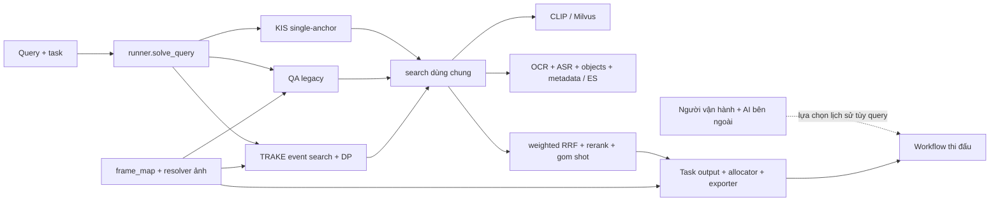

# Chu kỳ phát triển sau sơ tuyển — STOP POINT 1

Ngày audit: 11/09/2026. Baseline ID: **PP-B0-20260911**. Trạng thái: **đã chụp bằng chứng để duyệt Phase 1–3; chưa đóng được baseline chạy sạch, chưa triển khai Phase 4**.

**POST-PRELIMINARY / POST-COMPETITION INTERNAL EVALUATION.** Các thống kê mới ở đây là phân tích lại artefact lịch sử hoặc kiểm tra kỹ thuật ngày audit. Chúng không phải một lần chạy accuracy mới và không phải điểm BTC.

Điểm cuối 8,6/13, 13,6/15, 11,8/17 thuộc **FINAL COMPETITION WORKFLOW** ngày 21/08, 28/08 và 04/09: retrieval nội bộ, người kiểm ảnh/xếp hạng/tìm ứng viên thủ công, ChatGPT/Claude bên ngoài tùy query. Không dùng các điểm này làm benchmark engine, không tính human/ChatGPT/Claude uplift. Không suy số query thay đổi thành đóng góp của một tác nhân.

Yêu cầu gốc: [request.txt](request.txt). Báo cáo kỹ thuật v1 và mọi audit trước đây giữ nguyên; bản sao có checksum nằm trong gói baseline. Tài liệu này là hồ sơ quyết định kỹ thuật, **không phải báo cáo v2**.

## A. Baseline và khả năng tái lập

### A1. Định danh được đóng băng

| Thành phần | Bằng chứng và trạng thái |
|---|---|
| HEAD | `8fee5fd07bfd03d945fe93d474ffe2c29a4b7106`, commit ngày 04/09/2026 18:19:31 +07:00 |
| Branch | `main`, ahead `origin/main` 2 commit theo local tracking; không fetch để thay trạng thái tham chiếu |
| Working tree | 2 tracked file đã sửa từ trước: `.claude/launch.json`, `scripts/txt_to_run_queries.py`; còn nhiều untracked, gồm query đợt 3, báo cáo/audit và test. Không commit hoặc bỏ thay đổi của người dùng |
| Bản source để so sánh | Commit **cộng working tree** được chụp, không gọi đây là clean commit baseline. ZIP chứa 273 source/config/test/query/GT/manifest file được liệt kê riêng |
| Tham chiếu Git | Ghi full commit + tree SHA trong manifest thay cho tag. Tag trên HEAD sẽ không chứa dirty diff và báo cáo v1 chưa tracked nên không đủ định danh baseline này |
| Báo cáo v1 | `output/pdf/ThanhNghe_TechnicalReport.pdf`, SHA-256 `1e4f6d6132e554aeeff47724e9fae8603765422fe440e3e39f36f8bbb8fad0d0`; Markdown SHA-256 `40308af47b63cb730bb5371f55be7c5c165d8fb005cc9295f972c424f2bb7e60` |
| Historical archive | 37 file báo cáo/audit được sao chép; giữ cả bản trước editorial, phân biệt với PDF v1 hiện tại |
| Dữ liệu | SHA-256 của 28 parquet/meta/manifest trong baseline; inventory dữ liệu thật ở [runtime_data_inventory.json](runtime_data_inventory.json) |
| Cache/evidence | Snapshot bổ sung gồm cache adapter, cache Q&A, các run chẩn đoán được dùng và trace/checkpoint/CSV/ZIP local round2/round3. Xem [evidence_checksums.json](evidence_checksums.json) |

Artefact chính:

- [Manifest baseline](baseline_capture/manifest.json), [checksum gói baseline](baseline_capture/checksums.json).
- [Source snapshot](baseline_capture/source_snapshot.zip), [Git diff](baseline_capture/git_diff.patch), [Git status đầy đủ](baseline_capture/git_status.txt).
- [Báo cáo v1 và audit lịch sử](baseline_capture/historical_report_v1_and_audits.zip).
- [Snapshot evidence/cache](evidence_and_cache_snapshot.zip). ZIP local `submissions/round3/submission.zip` trong đó **không được đồng nhất với final H5/11,8** của audit trước.

`capture_baseline.py` là công cụ chụp bằng chứng, không thuộc production. Nó từ chối chạy đè `baseline_capture/`. Không đổi config, scorer, query, GT, index, raw asset hoặc submission lịch sử trong lượt này.

### A2. Kiến trúc và chế độ thực tế ở HEAD

Đây là sơ đồ **code hiện tại**, không dùng để xác nhận cấu hình đã chạy ở từng ZIP được chấm. Pipeline tự động của chu kỳ mới được đo riêng, không nhận đầu vào do người chọn đáp án trong lúc chạy.

| Hạng mục | Snapshot thực tế; điều kiện áp dụng |
|---|---|
| KIS | `multi_anchor.ENABLED=False`; `runner.KIS_BRANCH_OVERRIDE={vector_siglip2:False, ocr_probe:True}`; 100 dòng, pool 1.500/nhánh trước fusion, gom shot |
| Fusion | weighted RRF, `RRF_K=7`; vector 1,0; objects 0,7; OCR 0,6; ASR 0,6; metadata 0,4; OCR probe 1,0. SigLIP2 weight 1,0 và text_vi 0,6 được khai báo nhưng các nhánh ấy đang tắt |
| Rerank | Heuristic top-50 bật: consensus 0,30; cosine 0,25; vector agreement 0,20. Khi nhánh vector thứ hai tắt, thành phần agreement không có tín hiệu. Không có bằng chứng runner mặc định gọi VLM agentic reranker |
| Slot KIS | `SLOT_BUDGET=[(50,2)]`, inset 0,10. Đây là cấu hình thật khác bảng `[(1,2),(2,2),(94,1)]` còn ghi trong AGENTS.md; giữ nguyên để audit, chưa promotion lại |
| Video prior | Tắt. Có test alpha ngoài miền đang fail; không tự bật prior để làm test xanh |
| Q&A | Default `legacy`; main retrieval + text fallback quota 5 + mở rộng trong video; inference legacy thường `n=3`, max_tokens 2048; có mode `two_stage` sau cờ, chưa có bằng chứng promotion đủ điều kiện |
| Q&A khi không có answer | Code có đường tạo `TODO` hoặc `0`, confidence 0 và `provenance=placeholder:no_answer:legacy`. Đây là đường phục vụ người hoàn thiện bài, không được coi là answer autonomous có bằng chứng |
| Q&A portfolio | Phải truyền policy khi release. Chu kỳ mới đề xuất giữ `robust`; baseline snapshot không chứng nhận policy của một run chưa thực hiện. Semantic/exact/robust phải replay cùng evidence/answers |
| TRAKE | Search từng event pool 1.000, top-20 candidate/event/video; DP giữ vị trí event + frame tăng; min_gap=30; order bonus 5; min-blend 2; ASR context bonus 1. Export định mức 20 video × 5 phương án, có padding/nội suy |
| Ảnh/frame | Caller dùng resolver; frame từ frame_map. `keyframe_ids[j]=None` trong TrakeCandidate chỉ vị trí nội suy, không phải frame có bằng chứng trực tiếp |
| CLIP | `ViT-B-32-quickgelu`, pretrained `openai`, 512 chiều, COSINE + L2; meta BTC `clip-ViT-B-32` |
| Model khác | SigLIP2 cấu hình `ViT-SO400M-16-SigLIP2-256/webli`, 1.152 chiều, đang tắt. Text VI cấu hình `dangvantuan/vietnamese-embedding`, 768 chiều, đang tắt; meta BGE-M3 1.024 chiều tồn tại riêng. Không tự kích hoạt bất kỳ model nào |

Nguồn: [runner](../../backend/tasks/runner.py), [search](../../backend/retrieval/search.py), [config](../../data/config), [Q&A](../../backend/tasks/qa.py), [TRAKE](../../backend/tasks/trake.py), [exporter](../../backend/export/exporter.py). Toàn bộ bytes source/config tương ứng đã nằm trong ZIP baseline.

**Prompt phải gắn đúng call path.** Search single-anchor dịch qua `backend/retrieval/text_query.py::translate_to_english` (một phrase EN, max_tokens=128), không mặc định gọi bộ translate/expand/constraints ở `query_understanding.py`. Module expansion có code không chứng minh nó được dùng trong KIS hiện hành. Prompt Q&A nằm ở `_build_planner_prompt`, `parse_question`, `ask_llm`, `_infer_legacy`/`_infer_two_stage` và version `qa-planner-v2`, `qa-evidence-v2`; TRAKE có `_parse_events_llm`/`parse_events`. Source snapshot giữ cả template và logic ghép prompt, nhưng chưa có request mới để chứng nhận prompt đã render cho một run hậu sơ tuyển.

Kiểm bằng tokenizer CLIP hiện tại trên 55 chuỗi trong `official_r1r2.en.json`: **0/55 vượt 75 payload tokens**, lớn nhất 47 (chưa cộng token bắt đầu/kết thúc). Kết quả ở [translation_token_audit.json](translation_token_audit.json) loại trừ truncation do độ dài ở đúng file đã kiểm; không xác nhận semantic fidelity và không áp cho bản dịch của mọi query thi.

**LLM chưa được người vận hành chọn cho run mới.** Process audit ban đầu không có `LLM_BACKEND`/`LLM_API_MODEL`; code default là `api`/`claude-opus-5`. Preflight lại in `api`/`claude-sonnet-5`: probe cô lập xác nhận `check_core_libs()` làm hai biến unset được điền từ `.env` khi import dependency. Xem [preflight_env_probe.json](preflight_env_probe.json). Không lấy giá trị đó làm lựa chọn release đã được duyệt. Chỉ ghi boolean sự hiện diện key; không gọi API hoặc kiểm credit.

### A3. Dữ liệu và index identity

| Lớp | Số đo ngày audit | Giới hạn |
|---|---:|---|
| Raw BTC keyframe | 177.321 JPG / 873 thư mục video | Count ảnh không phải pixel parity |
| Derived frame cache | 0 JPG tại đường mặc định | Resolver raw vẫn có ảnh; không suy thiếu ảnh toàn hệ thống |
| frame_map | 177.321 dòng / 873 video | Loader tạo thêm alias, preflight báo 354.642 khóa; không có 354.642 ảnh độc lập |
| keyframes / clip_kf_map | 371.702 dòng mỗi bảng / 873 video | Bảng dẫn xuất khác quần thể raw BTC; không dùng số này làm số vector live |
| shots | 100.810 / 873 video | Giữ SHA-256 riêng |
| OCR | 160.393 dòng / 872 video | 1/873 video không có dòng OCR; không suy đó là lỗi nếu frame không có chữ |
| ASR | 13.415 đoạn / 783 video | 90/873 video không có ASR; không suy mọi đoạn còn lại có answer cần tìm |
| ASR clean provenance | 9.210 đoạn nguồn Gemini; 4.205 raw fallback theo meta 04/09 | Không coi fallback là transcript sai; chất lượng clean chưa được đo độc lập ở đây |
| CLIP index meta | `keyframes`, 177.321 vectors, build `2026-08-20T10:38:02Z`, commit `d496ecb` | Đây là meta trên đĩa, không xác nhận row count/live collection hiện tại |

Milvus mặc định `http://localhost:19530`, collection `keyframes`; SigLIP2 phụ `keyframes_siglip2` đang tắt. ES mặc định `http://127.0.0.1:9200`, index `metadata`, `objects`, `ocr`, `asr`. Compose khai báo Milvus `v2.4.17`, ES `8.13.4`; **chưa xác minh image digest hay phiên bản server đang chạy**.

Cả hai service không kết nối được từ môi trường audit. UUID/collection ID, schema/index live, primary-key/content digest, alias, số entity live, volume snapshot và quan hệ giữa meta/file với DB đều **UNKNOWN**. Không dựng lại index hoặc khởi động ingest để che lấp trạng thái này. Pixel parity 84/873 và CLIP cosine 12 mẫu (mean 0,9999, min 0,9993) là bằng chứng lịch sử, chưa được chạy lại và không đại diện toàn kho.

### A4. Runtime và checks mới

| Lệnh/môi trường | Kết quả |
|---|---|
| `python scripts/selfcheck.py` với `C:\Python314\python.exe` | Exit 1; Python 3.14.0 nhưng không có pytest/numpy/pandas/pyarrow/torch/ES/Milvus SDK; preflight 5 đạt / 13 hỏng / 3 skip |
| `.venv\Scripts\python.exe scripts/selfcheck.py` | Exit 1; **883 passed, 1 failed, 1 skipped**, 2 warning, test 214,59 giây; toàn selfcheck 284,12 giây |
| `.venv` development preflight | Exit 1; **13 đạt / 1 hỏng / 7 skip** |
| `.venv` release preflight | Exit 1; **13 đạt / 6 hỏng / 2 skip**; các mục bắt buộc phụ thuộc DB không được bỏ qua |
| Export rehearsal trong preflight | 3 task × 100 dòng qua validator ZIP; kiểm format không chứng minh answer đúng hoặc có evidence |
| Probe export hiện tại | Predicate Q&A bác `Không đủ căn cứ xác định`, nhưng `validate_submission()` vẫn không báo lỗi cho chuỗi này; `TODO` và `0` cũng qua probe. Không được bác mọi `0`, vì 0 có thể là đáp án thật |

Package `.venv` được kiểm riêng: Python 3.14.0, pytest 9.1.1, pandas 3.0.5, pyarrow 25.0.1, numpy 2.5.2, torch 2.13.0+cpu, open_clip_torch 3.3.0, elasticsearch 8.19.3, pymilvus 3.0.1, anthropic 0.125.0, google-genai 2.19.0. Danh sách đầy đủ trong inventory; requirements hiện dùng range, không phải lockfile cho môi trường thi.

Không dùng `.venv` để tuyên bố `python` mặc định đã được sửa: cả hai kết quả đều được ghi. Preflight bổ sung đặt `HF_HUB_OFFLINE=1`, `TRANSFORMERS_OFFLINE=1` để không tải model khi chẩn đoán; TEMP/TMP được chuyển vào thư mục audit. Lệnh selfcheck `.venv` trước đó chạy không có hai override offline này. Không đổi provider/model.

Test fail mới được tái hiện: `tests/test_video_prior_probe.py::test_alpha_ngoai_khoang_bi_tu_choi`, `_search_core("x", "y", video_prior_alpha=1.5)` không raise `ValueError` trong trạng thái hiện tại. Code return sớm khi không có candidates (search.py dòng 537), trước kiểm alpha (dòng 588); trace xác nhận các nhánh DB đều lỗi/trả rỗng. Đây là lỗi validation/config phụ thuộc hạ tầng, chưa có bằng chứng gây mất điểm thi. `.pytest_cache` còn tên test warmup đã đổi; lần gọi nhầm tên cũ không collect test, được lưu riêng và không tính là regression thứ hai.

Logs: [selfcheck system](checks/system_python_selfcheck.log), [selfcheck venv](checks/project_venv_selfcheck.log), [preflight development](checks/development_preflight.json), [preflight release](checks/release_preflight.json), [test fail](checks/alpha_failure.log), [probe export](export_diagnostics.json). **Không tuyên bố hệ thống “xong” khi selfcheck còn exit 1.**

### A5. Khoảng trống tái lập và tập đánh giá

Baseline đã lưu đủ source/config/evidence để nhận diện và phân tích, **chưa đủ để tái tạo một full run tương đương**. Các gap cần đóng trước đo accuracy mới:

1. Live index identity/backup và nguồn dựng lại tương ứng với đúng data manifest chưa có; khôi phục DB là hoạt động cần định danh riêng, không tự coi dữ liệu mới giống baseline cũ.
2. Chưa có model được người vận hành chọn tường minh; preflight có side effect `.env`; runtime fingerprint hiện không bao phủ toàn bộ adapter/prompt source, dependency, data/index, cache hoặc `VECTOR_BACKEND` như identity thực thi đầy đủ.
3. Working tree bẩn; phải chọn source ZIP này làm arm B0 hoặc tạo clean commit sau duyệt, không ghép code chưa truy nguồn vào experiment.
4. Chưa có accuracy run bằng đúng source/config/index hiện tại. Các run KIS 03/09 dùng dual-vector; HEAD 04/09 đã tắt nhánh này. Không chuyển điểm 0,6421 sang B0.
5. Một số file `run_20260903_ab_{p1,p2}` được tài liệu nhắc nhưng thư mục không có trong checkout. Bảng A/B đó chỉ là bằng chứng tài liệu; không giả vờ đã tính lại query deltas của chúng.
6. Chưa có GT độc lập đủ điều kiện promotion; raw video/frame dày, model weights immutable, server snapshots và wheel lock chưa được đóng băng. Hash hiện có không thay thế những bytes còn thiếu.

| Tập | Vai trò được phép trong chu kỳ mới | Vì sao / độ tin cậy |
|---|---|---|
| Tune: 23 KIS + 5 QA + 2 TRAKE | **TRAIN/TUNING + regression** | Đã dùng nhiều lần; baseline lịch sử overall semantic 0,4817, exact 0,4017. Không dự báo điểm thi |
| dress25: 19 KIS + 5 QA + 1 TRAKE | **DIAGNOSTIC / tuning đã quan sát** | GT legacy chưa verified; đã dùng chọn rollback/fix. Có candidate/evidence/score để replay cấu trúc và chẩn đoán |
| gen2, gen10, synth | **TUNING/synthetic diagnostic** | Query sinh bằng model; gen10 gắn `split=tune`; không dùng làm độc lập hoặc GT người kiểm |
| Legacy holdout: 36 KIS + 27 QA + 29 TRAKE query | **DIAGNOSTIC đã tiêu thụ** | Nhật ký đã dùng để đổi RRF/QA; GT auto-BM25, TRAKE single-window không đủ event windows; không suy count record trong file thành denominator của run cũ |
| `batch1_holdout13` | **Regression một phần verified** | 6/13 verified theo manifest, đều KIS; 7 pending. Là subset của tập đã dùng, human verification thêm không làm nó trở lại độc lập |
| `batch1_round1_queries` | **Competition-query regression, chưa promotion** | Manifest có 25 query nhưng 0/25 GT digest. Điều này nói về manifest ấy, không phủ nhận file proxy `official_r1r2` tồn tại |
| `official_r1r2` p1 | **TUNING/diagnostic, competition-derived** | 20 KIS trong run được phân tích; GT lấy dòng submission và confidence prior, không phải đáp án BTC từng query |
| `official_r1r2` p2 | **Validation lịch sử đã dùng chọn cấu hình; nay diagnostic** | 19 KIS, đã mở và chọn arm tháng 9; nhật ký ghi hết holdout. Không gọi unbiased trong cycle mới |
| Official TRAKE 3 query | **Diagnostic đã dùng** | GT frame proxy, dùng thử R3.T1/T2; p2 cũng đã mở |
| Local trace round3: 26 KIS + 8 QA + 2 TRAKE | **COMPETITION DATA / postmortem** | Dùng đếm vận hành/placeholder/provenance, không dùng final submission làm nhãn đúng tự động |
| Held-out mới | **Chưa tồn tại tập sẵn sàng được chứng minh** | Cần người tạo/xác minh và tách theo video/near-duplicate trước khi mở kết quả; không tự chế một “holdout” từ query đã thấy |

`official_r1r2.meta.json` nói rõ confidence là prior từ điểm tổng, không phải kiểm từng câu. Trong 55 record chỉ 3 có trường `verified_by`, mang nhãn assistant; không được nâng chúng thành human-verified. Một tập được dùng liên tục để quyết định thiết kế sẽ bị ghi là diagnostic/tuning dù tên file vẫn chứa “holdout”.

## B. Taxonomy lỗi dựa trên bằng chứng

Các hàng có thể chồng lấp, không cộng tỷ lệ thành 100%. Đơn vị đếm được ghi rõ; nhãn lỗi tự động trong scorer là triệu chứng, không tự chứng minh root cause. “Video không vào 100 dòng” chưa cho biết mất ở retrieval raw, fusion, rerank hay allocator.

| Lớp lỗi | Tần suất/phạm vi đo được | Severity; task | Nguyên nhân khả dĩ, confidence | Can thiệp có thể kiểm chứng |
|---|---|---|---|---|
| Runtime/config/index không đúng identity | 1 probe preflight tự đổi 2 biến model; 1 test alpha fail; DB hiện không truy cập được. Head tắt SigLIP2 khác run 03/09 | Critical cho validity; tất cả | Import dependency nạp `.env` đã tái hiện; index hiện unavailable. Không suy provider hết credit | Guard env không side effect; identity đầy đủ; branch diagnostics có cấu trúc; kiểm parameter trước truy cập DB |
| KIS đúng video, frame kém | p1: 7/19 video-found không match ±40; p2: **10/16**, và **15/16** không match ±5 | Cao; KIS | Định vị trong video, sparsity ảnh, gom shot/allocator và GT proxy có thể cùng góp phần; medium cho nguyên nhân, high cho thống kê artefact | Cùng candidate pool, đo khả năng match có sẵn trước allocation rồi thử định vị trong shot; GT người kiểm trước claim accuracy |
| KIS video vắng ở export100 | p1 1/20; p2 3/19 | Cao; KIS | Retrieval miss hoặc mất sau fusion/rerank/slot, chưa phân xử; low–medium | Giữ raw pool → fused → reranked → exported cho từng query; ablation khi xác định tầng mất |
| Candidate đúng video xếp dưới top-5 | p1 5/20; p2 6/19 | Cao; KIS | Nhiễu chủ đề, fusion, reranking hoặc duplicate/slot; medium | Rank từng stage và từng nguồn; không tăng pool/weight mù |
| Fusion/shot trade-off | Multi-anchor dress19: Final 0,4000→0,3263, 4 win/5 loss/10 hòa; rollback 0,4000 | Cao; KIS | Mất precision/recall trong setup ấy, causal attribution chưa hoàn hảo do LLM/runtime; medium | Giữ tắt. Nếu xét lại phải có thay đổi cụ thể + experiment falsifiable mới |
| Q&A thiếu evidence bị ghi thành success | Local R3 **3/8 query**, 30 placeholder hypotheses; q14/q24/q6. Ba CSV tương ứng mỗi file 99 dòng `TODO` và validator hiện không báo lỗi | Critical cho autonomous-output integrity; QA | Fallback cố ý phục vụ người điền answer; high qua code + trace + CSV | Tách `needs_review` khỏi success; chặn placeholder theo provenance khi đánh giá/phát hành autonomous, giữ candidate cho review |
| Refusal/sentinel lọt export/cache cũ | RUN3 dress QA01 2 dòng sentinel lịch sử; probe hiện QA predicate bác nhưng export không bác | Cao; QA | Predicate upstream và exporter khác hợp đồng; branch fix 01/09 chưa ở HEAD; high | Predicate chung ở cả live/inference/cache replay/export; kiểm end-to-end, không chặn mọi phủ định hay số 0 |
| Q&A thiếu bằng chứng sau tìm kiếm | Dress 1/5 query fail; R2 q19 fail 3 attempt của **1/9 QA query**, sau đó có manual override | Cao; QA | Candidate/evidence không đủ, không chứng minh answer reasoning riêng hỏng; high cho thiếu evidence, medium cho tầng gây thiếu | Evidence coverage và candidate-specific pinning; không tính retry thành 3 query và không tính manual override là autonomous recovery |
| Q&A answer sai/unsupported khác placeholder | Chưa có tỷ lệ human-verified đáng tin cho 8 QA R3; 5 answer còn lại không được coi là đúng chỉ vì có string | Cao; QA | Visual counting/reading, route, evidence hay hallucination chưa phân xử | Annotate answerable/evidence-support/correctness trên tập người kiểm; báo UNKNOWN khi chưa có nhãn |
| TRAKE nội suy thay bằng chứng | Local R3 q21: 94/100 candidate có nội suy, 209/400 vị trí; q34: 79/100, 166/400. Top-20 tương ứng 18/20 và 8/20 candidate | Cao; TRAKE | Rổ event thiếu hoặc DP chỉ chọn subsequence; high về provenance, chưa biết correctness | Persist evidence mask từng phương án export, ưu tiên chuỗi đủ event; không gọi frame tăng dần là tìm đủ event |
| TRAKE định vị/gap constraint | 3 official diagnostic: exact/±5/±15 đều 0 trước và sau R3.T1; ±40 đều 0,25. Đúng video hạng 1 ở 2/3 query nhưng điểm frame nhỏ | Cao; TRAKE | Sparse candidate + min_gap=30 có thể loại sự kiện sát nhau; 2/3 proxy query có gap <30. Chưa xác minh GT/candidate inclusion nên chỉ medium/low causal confidence | Kiểm candidate recall trước DP; test event nhanh vs near-duplicate; không sửa min_gap chỉ để khớp proxy |
| Translation/caption drift | TRAKE R3.T2 ghi 3 event p1 fallback tiếng Việt vì lỗi dịch; KIS p1 dịch tay vs frozen LLM cho Final video 0,83 vs 0,80 | Cao nếu xảy ra; mọi task | Lỗi runtime đã có evidence, còn semantic drift chưa có human audit toàn tập | Log fallback và bản dịch thực thi; clip-token/semantic audit; không suy dịch tay luôn tốt hơn, không đổi model |
| OCR/ASR/object signal | ASR vắng 90/873 video, OCR vắng 1/873; nhánh text_vi tắt; chưa có ablation source-level mới | Medium–cao tùy query | Coverage khác content quality; detector count khác VLM count; causal confidence thấp | Theo dõi evidence đủ/trống/sai entity; ablation trên pool cố định sau khi có GT |
| Latency Q&A | Dress 5 QA: median 360,622s, max 476,212s; 140 inference batch × 3 = 420 generation, cộng 15 planner/dịch theo audit. Local R3 median **359,604s**, max **542,254s** / 8 QA | Cao về vận hành; QA | Candidate fan-out + n=3 tuần tự + escalation ảnh; high ở dress trace | Budget evidence-first/two-stage thử riêng sau gate chất lượng; đo cả generation và wall time |
| Latency TRAKE/KIS | R3 KIS median 6,675s, max 42,337s /26; TRAKE 55,350 và 97,803s /2 | Medium; KIS/TRAKE | Cold load, event search và cache khác nhau; chưa đo thành phần đầy đủ | Ghi cold/warm, stage time; không suy speedup từ arm dùng cache khác |
| Mapping/export | Dress single-anchor: 0 mapping/row-count/crash violation /19; preflight hiện 3×100 format pass. Pixel parity toàn kho chưa đủ | Critical nếu sai; tất cả | Chưa có bằng chứng regression mapping mới trong audit này | Giữ map/resolver/validator; kiểm trên candidate và export; không gán format pass thành correctness |

Các query KIS cụ thể và denominator nằm trong [kis_query_diagnostics.json](kis_query_diagnostics.json). Trace/query QA ở [trace_diagnostics.json](trace_diagnostics.json); thống kê TRAKE và timing ở [round3_trace_summary.json](round3_trace_summary.json). Tái tính trực tiếp từ ZIP đã đóng băng bằng `python reports/post_preliminary_cycle_20260911/analyze_evidence.py`, kết quả [recomputed_diagnostics.json](recomputed_diagnostics.json). Tỷ lệ TRAKE trên **candidate chính**, không phải tỷ lệ dòng CSV cuối: alternative/padding cần provenance riêng để đo chính xác.

Không kế thừa các diễn giải lịch sử như “điểm là sàn”, “chắc chắn không overfit”, “Claude uplift” từ ghi chú cũ. Chỉ giữ số đo và giới hạn nguồn; tài liệu cũ được bảo tồn nguyên văn.

## C. Tối đa 5 ưu tiên chính

Xếp hạng theo `Impact × Evidence × (1/Cost) × (1/Risk)`. I/E/C/R đều là thang ordinal 1–5; C và R cao nghĩa tốn công/rủi ro hơn, nên lấy nghịch đảo. Đây là heuristic ưu tiên công việc, không phải dự báo điểm tăng. Công ước này tránh việc vô tình thưởng cho thay đổi đắt và rủi ro. Ước lượng công chỉ để sắp thứ tự, không phải cam kết thời hạn.

| Thứ tự | Target / experiment family | I | E | C | R | Chỉ số | Công dự kiến |
|---:|---|---:|---:|---:|---:|---:|---|
| 1 | **PP-H01: baseline chạy được và gate runtime/index/evaluation** | 5 | 5 | 2 | 1 | 12,50 | 1–2 ngày chủ động, chưa gồm chờ hạ tầng/GT/model |
| 2 | **PP-H02: Q&A autonomous output có evidence, chặn placeholder/refusal xuyên suốt** | 5 | 5 | 2 | 2 | 6,25 | 2–3 ngày |
| 3 | **PP-H03: KIS định vị frame và phân bổ slot có đối chứng** | 5 | 4 | 3 | 3 | 2,22 | 3–5 ngày, chưa gồm pixel/video thiếu |
| 4 | **PP-H04: TRAKE provenance từng event và localization có kiểm chứng** | 4 | 4 | 3 | 3 | 1,78 | 3–4 ngày |
| 5 | **PP-H05: giảm generation Q&A trên cùng evidence** | 3 | 5 | 3 | 3 | 1,67 | 3–5 ngày và quota model được duyệt |

Ba hướng đã cân nhắc: (a) sửa correctness/reproducibility rồi localization — **đề nghị chọn**; (b) khôi phục SigLIP2 và nới candidate trước — có evidence trước 04/09 nhưng thiếu immutable index, chi phí chưa kiểm; (c) đổi model/reranker/kiến trúc lớn — attribution khó và thiếu independent GT. Hướng b chỉ mở như experiment riêng nếu hạ tầng chứng minh khả thi; hướng c chưa vào đợt đầu.

## D. Giả thuyết và phép bác bỏ

### PP-H01 — Runtime, index và phép đo phải có identity đúng

1. **Problem:** không có clean runnable B0; model đổi khi import; test alpha fail; live DB chưa xác nhận; run cũ có nhãn rerank theo CLI khác thực thi.
2. **Evidence:** A3–A4, `preflight_env_probe.json`, `checks/alpha_failure.log`; `runner.runtime_manifest()` chỉ hash một số source/config; run p2 03/09 ghi `rerank_top50=false` trong khi audit ghi lỗi metadata đó đã được phát hiện.
3. **Hypothesis:** chặn lệch identity trước run và ghi trạng thái nhánh sẽ loại bỏ phép đo giả hợp lệ mà không đổi answer trên cùng input hợp lệ.
4. **Implementation đề xuất:** chia thành H01a validation/import environment; H01b manifest source+prompt+model+package+data+live index/cache/scorer; H01c harness chạy đúng `solve_query`, ghi raw/fused/reranked/exported và branch status. Mỗi phần một commit/experiment; read-only DB qua client tập trung. Không tự chọn model, không ép bật nhánh tắt. Chọn `.venv` tường minh cho test/run sau duyệt và lưu lock/version thực tế; không che lỗi Python hệ thống.
5. **Metrics:** identity mismatch detection, no-side-effect probe, 0 unexpected branch failure, mapping/export violations, replay output digest; chưa kỳ vọng tăng accuracy.
6. **Regression:** over-strict gate có thể chặn run hợp lệ hoặc thêm I/O. Disabled branch phải khác failed branch; không coi zero hits nội dung là lỗi service.
7. **Evaluation:** fixture gồm env unset/explicit, key chỉ ở `.env`, import order, collection missing/empty/schema đổi, đổi model/vector backend/adapter prompt/cache; replay output hợp lệ phải giữ nguyên. Khôi phục live index chỉ sau khi chốt identity, rồi kiểm COSINE/L2 và encoder–feature parity nếu đủ asset.
8. **Rollback:** reject nếu import vẫn đổi lựa chọn operator, manifest thiếu trường critical, baseline/candidate không cùng identity ngoài một biến dự kiến, hoặc output hợp lệ thay mà chưa giải thích. Test alpha sửa đúng input contract, không xóa test hay bật prior để vượt gate.

### PP-H02 — Answer thiếu bằng chứng phải được phân loại đúng

1. **Problem:** placeholder phục vụ người điền đang đi qua `success`; exporter không chặn refusal dù upstream biết bác.
2. **Evidence:** 3/8 local QA R3, 30 placeholder hypotheses, 297/300 dòng `TODO` trong ba CSV; probe hiện xác nhận validation gap. Không gán chúng cho final ZIP được chấm.
3. **Hypothesis:** tách `needs_review`/unsupported và dùng kiểm tra chung ở mọi đường live/cache/export sẽ làm sạch autonomous output mà không làm mất answer có evidence.
4. **Implementation đề xuất:** policy có tên trong config cho assisted-review và autonomous evaluation; lưu candidate/evidence khi không answer; unsupported vẫn tính là thất bại trên denominator, không biến thành query thành công bằng cách bỏ khỏi run. Áp kiểm semantic-format cùng provenance cho checkpoint cũ, portfolio và release rehearsal. Tái dùng logic branch fix 01/09 sau review, không cherry-pick mù. Giữ CSV lịch sử nguyên vẹn. Không bác số `0` theo chuỗi; bác provenance placeholder hoặc evidence thiếu.
5. **Metrics:** placeholder/refusal accepted as autonomous = 0; invalid rate; evidence-backed coverage; answer correctness trên GT human-verified; rejected-valid-answer count; completion/abstention rate.
6. **Regression:** mất coverage hoặc chặn phủ định đúng (`Không thấy mưa`, `Không có người trong ảnh`), answer `0` đúng; làm lại lỗi fail một QA chặn toàn bộ khả năng review.
7. **Evaluation:** cùng 280 evidence record/41 hypotheses dress làm structural replay; đối chứng raw legacy trace/CSV có sentinel; fixture legitimate negatives/zero/manual override; run human-verified QA sau đó. Không gọi việc loại TODO là tăng accuracy, và không bỏ denominator để điểm đẹp hơn.
8. **Rollback:** bất kỳ answer đã verified có evidence bị loại sai; placeholder còn được gọi autonomous success; candidate review bị mất; hoặc policy không được persist. Nếu thiếu evidence thật, báo thiếu, không tạo answer thay thế.

### PP-H03 — Tăng chất lượng định vị trong tập ứng viên đã tìm được

1. **Problem:** có video ở top-100 nhưng frame không khớp; chưa biết phần mất do pool, gom shot hay allocator.
2. **Evidence:** p2 16/19 video-found nhưng 10/16 không khớp ±40; `final_frame` lịch sử ±5/±15/±40 = 0,0316/0,0947/0,1895. Đây là trung bình điểm trên các cutoff, **không phải frame R@100**.
3. **Hypothesis:** với candidate video/pool cố định, chọn frame theo bằng chứng thời gian/cảnh trong shot và bảo toàn candidate tốt qua allocation sẽ tăng localization hơn việc chỉ tăng recall video.
4. **Implementation đề xuất:** H03a chỉ đo oracle candidate availability và mất ở từng stage; H03b một selector frame cục bộ có rollback flag, giữ 100 dòng và breadth cố định ban đầu. Chỉ mở dense pixel/video cho candidate đã đo cần; cache/resume, model qua adapter, frame tra map. Thử `50×2` với bảng 97 shot chỉ là ablation có đăng ký trước, không sửa mặc định ngay.
5. **Metrics:** KIS R@1/5/20/50/100 ở frame GT windows; video R@k riêng; frame error có điều kiện đúng video; candidate recall trước/ sau allocation; duplicate/shot coverage; latency.
6. **Regression:** bớt video coverage, chọn frame sát nhưng sai hành động, lợi giả do frame proxy bám keyframe BTC, tăng I/O/VLM cost.
7. **Evaluation:** frozen translation/model/index; baseline/candidate chia raw hit cache; một biến mỗi arm. Chẩn đoán trên p1/p2 cũ; chốt thiết kế rồi dùng validation/held-out mới có người xác minh. Khi chỉ có proxy, báo exact/±5/±15/±40 như sensitivity, không gọi official accuracy. So cả winner lẫn query bị đẩy khỏi top-100.
8. **Rollback:** không đạt gate quality đăng ký trước; thêm retrieval miss ở query verified; bất kỳ mapping sai; hoặc localization gain chỉ xuất hiện khi đổi GT/translation/data đồng thời. Nếu oracle cho thấy frame đúng không có trong pool, dừng tuning allocator, chuyển sang thu thập evidence/candidate có đo lường.

### PP-H04 — TRAKE phân biệt tìm thấy event với nội suy

1. **Problem:** chuỗi frame tăng dần có thể chứa nhiều event chưa quan sát; alternative/padding mất độ rõ provenance. Tăng chiều sâu R3.T1 chưa tăng điểm trong test cố định.
2. **Evidence:** 375/800 vị trí candidate chính trong 2 trace R3 có keyframe=None; cả 2 top1 đủ keyframe theo metadata, **không suy top1 đúng nội dung**. R3.T2 3 query không cải thiện ở mọi tolerance; 2 query có video rank1 nhưng frame chưa tốt.
3. **Hypothesis:** evidence mask từng event/alternative và đo recall trước DP sẽ tìm đúng tầng cần sửa; ưu tiên chuỗi đủ bằng chứng có thể giảm unsupported output mà không mất event đúng.
4. **Implementation đề xuất:** H04a persist mask + keyframe/source cho cả alternative/padded row, không đổi ranking; H04b duy nhất một thay đổi selection/localization sau khi xác định candidate gap. Cân nhắc min_gap thích ứng chỉ nếu GT rapid-event đã verified; giữ event identity, không sort frame để sửa sai thứ tự.
5. **Metrics:** event recall trước DP, event match sau DP, all-event correctness, evidence-backed/interpolated position rate trên **export**, order violations, video recall và latency.
6. **Regression:** ưu tiên full-chain sai video, loại chuỗi partial có event đúng, giảm diversity, nới min_gap ghép cùng khoảnh khắc thành hai event.
7. **Evaluation:** replay R3.T2 bằng cùng event hits; tách cache-cold retrieval khỏi DP replay. Bộ người kiểm phải có missing event, rapid events, similar actions và order ambiguity. Không gọi 47s→0,438s trong hai arm cũ là speedup vì arm sau dùng hit cache đã ấm.
8. **Rollback:** order/mapping violation >0; event recall verified giảm; thiếu provenance row; hoặc tỷ lệ interpolation đẹp hơn chỉ vì loại query/candidate khỏi denominator. No gain thì giữ DP cũ, lưu experiment thất bại.

### PP-H05 — Tiết kiệm Q&A sau khi khóa evidence/output contract

1. **Problem:** n=3 tuần tự trên nhiều candidate; image escalation + video expansion chiếm phần lớn chi phí.
2. **Evidence:** dress 140 inference batch, 420 generations; median QA ~360s ở dress và R3. Không có retry counter chính xác hay query timeout bound.
3. **Hypothesis:** screening một lần và confirmation có điều kiện trên đúng evidence có thể giảm generation/time mà giữ chất lượng và candidate-specific answer.
4. **Implementation đề xuất:** đo lại mode `two_stage` có sẵn trước khi thêm thuật toán; cohort 1+2, cap 42 theo config. Giữ evidence/model và reset votes khi chuyển text→image. Chỉ thử budget/policy mới ở experiment sau; không gộp với đổi model, giảm pool hoặc bật async. Giữ `legacy` cho đến khi qua gate.
5. **Metrics:** successful/attempted generation, retry, tokens, cache hit, wall p50/p95, quality từng QA, unsupported/refusal rate, answerable-query coverage. P95 trên n nhỏ chỉ là mô tả mẫu.
6. **Regression:** screening bỏ candidate đúng ở rank thấp, budget cạn, evidence mismatch, confidence tự khai không đáng tin.
7. **Evaluation:** semantic/exact portfolio replay trên cùng answers trước; so mode cần cùng evidence nhưng **outputs model mới phải được capture riêng**. Dùng provider/model do operator chọn, paired query và repeats có seed nếu API hỗ trợ; báo stochastic variation, không coi hai lượt LLM ngẫu nhiên là một ablation chính xác. Cache-only replay đo logic, không dùng làm wall-time live speedup.
8. **Rollback:** quality/coverage verified giảm, unsupported mới, budget exhaustion mới chưa giải thích, hoặc lợi chỉ do warm cache. Mục tiêu dự kiến ≥25% giảm generation và median latency, **đây là tiêu chí đề xuất, chưa có kết quả**; không nhận nếu quality gate không qua.

## E. Protocol đánh giá đề nghị khóa trước Phase 4

### E1. Điều kiện bắt đầu và chia tập

1. Chốt một source B0 có thể phục hồi; tạo clean checkpoint sau duyệt; ghi mapping từ B0 dirty snapshot sang commit mới. Không sửa lịch sử báo cáo/ZIP.
2. Operator chọn model/backend bằng env process ngay trước run. Nếu thiếu key/credit hoặc lựa chọn model, dừng phần gọi API; không thử provider khác tự động. Env probe phải không side effect.
3. Chốt DB snapshot/collection IDs/index UUID/schema/count/content identity, raw/derived/model-weight checksum, package lock, prompt hash, cache/scorer identity. Nếu phục hồi index không chứng minh đồng nhất, tạo B0-restored mới và chạy cả arms trên nó.
4. Dùng các tập đã tiêu thụ cho diagnosis/tuning/regression. Không tăng quota holdout cũ để gọi lại thành độc lập.
5. Đề nghị tuyển **24 KIS, 12 QA, 8 TRAKE mới**, tách video/near-duplicate với tập đã dùng; chia trước khi chạy thành validation 12/6/4 và sealed held-out 12/6/4. Đây là kế hoạch thu thập, **chưa có dữ liệu/GT đó**; cỡ mẫu nhỏ phải báo denominator và độ bất định, không claim tổng quát mạnh.
6. Người thật xác minh bằng công cụ gallery/`mark_verified` hiện có theo schema được hỗ trợ; lưu query hash, frame windows/event windows, answer acceptable forms, nguồn/ảnh, thời điểm và evidence. Không tự phong verified; cần mở rộng schema cho tập mới thì là task code sau duyệt. Không đọc sealed outputs/labels khi đang tuning.

Không có independent set thì vẫn sửa correctness và làm diagnostic experiments, nhưng **không promotion theo claim accuracy độc lập**. Pending GT không chặn việc trình proposal ở STOP POINT 1.

### E2. Đơn vị run và attribution

Mỗi experiment dùng ID `PP-Hxx-Eyy`, hypothesis trước chạy, baseline/candidate commit, full config, process model, prompt, data/index identity, package/runtime, command, timestamp, scorer, query/GT hashes, cache mode và status. Từng query ghi input dịch/event, nhánh enabled/disabled/error/zero-hit, raw candidate rank, fused/reranked/allocated rank, evidence, answer, time và error. Artifact path dùng thư mục mới; không ghi vào run lịch sử.

Một experiment = một biến. B0 → sửa correctness/gate là B1 có ledger; tuning sau so với B1, nhưng cuối cycle vẫn có B0 vs final trên **cùng protocol và resource identity**. Nếu thay resource, chạy lại B0 trên resource đó và tách gain do dữ liệu khỏi gain do code. Không dùng một bảng before/after khác model/index để nhận công cho reranker.

**Hai track riêng:** (a) replay trên frozen retrieval/evidence để cô lập logic; (b) end-to-end trên query mới để đo routing, dịch, retrieval, inference và latency thật. Replay không thay thế end-to-end. Mọi manual override, human translation hoặc external AI answer được gắn provenance; không xuất hiện trong autonomous test run.

### E3. Metric và denominator

| Task | Metrics bắt buộc |
|---|---|
| KIS | Frame R@1/5/20/50/100 và trung bình 5 cutoff theo scorer đã đóng; video R@k riêng; candidate availability trước fusion/allocator; frame localization error khi GT hỗ trợ; số query/video và windows rõ ràng |
| QA | Retrieval/evidence recall, answer correctness semantic và exact trên cùng answer/evidence, valid answer rate, refusal/placeholder rate, unsupported rate khi human label cho phép, answerable coverage, abstention, p50/p95 latency/generation |
| TRAKE | Event recall, full-chain/partial R-score theo scorer cố định, ordering, observed/interpolated per exported position, video correctness, frame correctness ở từng event, latency |
| Engineering | Crash/query failures, branch failures, model/config drift, mapping/export violations, stale-cache rejection, preflight failures, checksum reproducibility |

Denominator luôn là toàn bộ query đăng ký, kể cả fail/abstain/needs-review. Tỷ lệ unsupported chỉ báo trên phần đã được human audit và ghi rõ coverage; chưa audit ghi UNKNOWN. Không biến `status=success`, có 100 dòng, confidence cao hay full-order thành correctness.

Với `official_r1r2`, tolerance around submission frame chỉ là proxy sensitivity. Khi có GT window human-verified, dùng window đó cố định; không nới tolerance sau khi nhìn kết quả. Scorer semantic/exact hiện hữu được pin, không thay định nghĩa trong cùng experiment.

### E4. Gate chấp nhận và rollback

- Chạy focused tests, full applicable suite, development/release preflight, `python scripts/selfcheck.py` bằng interpreter được ghi rõ; giữ logs/exit code. Selfcheck hiện chưa xanh, chưa có release claim.
- Correctness fix: case gây lỗi phải bị bắt, đối chứng hợp lệ không đổi output, không thêm crash/mapping/export/route failure. Ghi rõ abstention đúng chính sách khác với process crash.
- Tuning: yêu cầu repo tối thiểu +0,02 tune hoặc cải thiện ≥2 query validation giữ riêng, không giảm aggregate validation và không thêm failure; **không đổi tên validation đã dùng thành unbiased holdout**. Đề xuất này bảo toàn ý nghĩa gate nhưng cần bộ mới, vì holdout cũ đã tiêu thụ. Sealed holdout chỉ dùng quyết định cuối một lần.
- Bất kỳ mapping/export violation mới, source/model identity mismatch hoặc suy answer không có evidence đi thành success đều bác bỏ.
- Luôn có query-level wins/losses/ties, moved-out-of-top100, answer-changed, event-lost, latency-regression. Kiểm mọi loss lớn; aggregate tăng không xóa regression.
- Với gain quan trọng, ablate pool, rerank, dịch, model, index và cache trong các arm riêng đủ để giải thích gain. Không chạy grid trên sealed set.
- Chọn final rồi freeze source/model/prompt/config/index/data/cache/scorer/query sets và chạy một rehearsal sạch không chỉnh giữa chừng. Chỉ sau đó mới tới report gate/claim ledger/figure/table/page-budget và điểm duyệt thứ hai; chưa viết PDF mới.

## F. Rủi ro và việc cần người vận hành quyết định

| Rủi ro | Cách kiểm soát / điều còn thiếu |
|---|---|
| Mọi bộ thuận tiện đều đã được nhìn/chọn cấu hình | Ghi role registry; thu thập human-verified set mới. Không thể giải bằng đổi tên file |
| Proxy GT bắt nguồn từ chính submission có hỗ trợ | Không dùng score tổng để suy query đúng; không tính assistant verification là human verification |
| Chỉ có ảnh thưa | Đo oracle trước; chỉ yêu cầu video/frame dày cho case thực sự cần, có checksum/provenance/resume |
| SigLIP2 mất và data/index drift | Không áp số dual-vector 03/09 cho HEAD; khôi phục thành arm resource riêng có identity, không mặc định encode lại hàng chục giờ |
| Model provider thay theo thời gian | Tên model không phải immutable provider weights; ghi timestamp/request metadata, model explicit, cùng evidence, repeats khi cần; giới hạn claim tái lập byte-for-byte |
| Fail-closed Q&A làm coverage giảm | Giữ candidate review, báo unsupported/needs-review và denominator đầy đủ; operator policy review phải khác autonomous evaluation |
| LLM confidence che evidence sai | Human label correctness/support; kiểm pin frame và provenance, không promote theo confidence |
| Test xanh nhưng trace/export cũ lọt sentinel | Regression từ cache/checkpoint/CSV xuyên suốt, shared predicate; validation format riêng |
| Baseline sửa môi trường bị mô tả thành sửa lịch sử | Mọi B0-restored/B1/candidate mang nhãn POST-PRELIMINARY; v1 và audit/ZIP giữ checksum |

Quyết định model/provider, xác minh GT và chọn nộp ZIP vẫn thuộc người vận hành. Lượt này chưa cần chọn đáp án, chưa gọi LLM, chưa nộp ZIP. Hạ tầng/GT còn thiếu được ghi thành gate của triển khai/đánh giá, không tự tạo bằng chứng thay thế.

## G. Thứ tự triển khai được đề nghị để duyệt

1. **PP-H01a:** sửa side effect model trong preflight và validation alpha; kiểm case đỏ + đối chứng, không đổi retrieval ranking. **PP-H01b/c:** runtime/index/evaluation manifest và khôi phục hạ tầng có identity. Tạo runnable B0-restored nếu cần, ghi nguồn mọi thay đổi.
2. **PP-H02:** chặn placeholder/refusal đi thành autonomous success ở live, replay và export; giữ policy review có provenance. Replay correctness trước gọi model mới.
3. **PP-H03a:** đóng GT/protocol, đo raw-pool/oracle → fusion → rerank → slot. Chỉ triển khai H03b sau khi bằng chứng chỉ ra nơi mất frame; candidate này ưu tiên tăng chất lượng KIS.
4. **PP-H04a/b:** provenance từng event/phương án TRAKE rồi thử đúng một thay đổi localization được diagnosis hỗ trợ; không mặc định giảm min_gap.
5. **PP-H05:** A/B legacy/two-stage bằng model operator chọn trên fixed evidence + validation mới; giữ legacy nếu chưa qua quality gate.

Mỗi bước thực hiện tuần tự, một thay đổi có baseline/command/evidence/query deltas/decision và rollback. Không tick BUILD_TASKS lịch sử hoặc sửa v1 để nói các bước này đã diễn ra trong thi đấu.

**Điểm dừng:** xin duyệt 5 target, protocol và thứ tự trên trước Phase 4. Đây là điểm duyệt do chính yêu cầu người dùng đặt ở **STOP POINT 1**. Chưa có implementation production và chưa có claim “phiên bản mới tốt hơn”.
