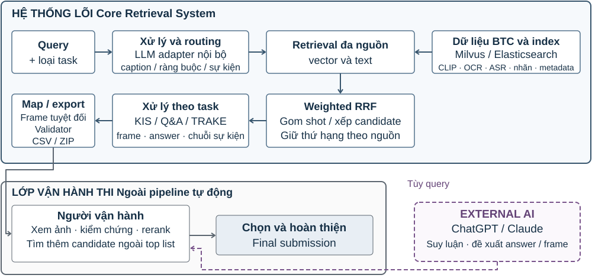

# Báo cáo kỹ thuật Vòng Sơ tuyển AI Challenge TP.HCM 2026

Đội Thanh Nghệ

## 1 Bài toán và đóng góp

Truy xuất khoảnh khắc video đòi hỏi đồng thời nhận diện đúng nội dung và định vị đúng thời điểm. Một video phù hợp về chủ đề vẫn có thể chứa nhiều cảnh gần giống nhau; tìm đúng video chưa đủ để chọn đúng frame. Đội Thanh Nghệ xây dựng hệ thống truy xuất đa phương thức cho ba dạng bài: KIS tìm khoảnh khắc theo mô tả, Q&A tìm bằng chứng và trả lời câu hỏi, TRAKE xác định chuỗi sự kiện theo thứ tự thời gian.

Hệ thống dùng chung hạ tầng tìm kiếm cho cả ba dạng bài, kết hợp tín hiệu hình ảnh, chữ trên hình, lời thoại, đối tượng và metadata. Đóng góp kỹ thuật tập trung vào hợp nhất candidate từ các nguồn khác đơn vị, liên kết kết quả với frame tuyệt đối, xử lý riêng theo task và tự động hóa kiểm tra/xuất submission. Các quyết định thay đổi retrieval được đối chiếu bằng diagnostic theo query; trường hợp hồi quy dẫn đến rollback và kiểm tra lại trước khi chọn cấu hình vận hành.

## 2 Kiến trúc và tổ chức dữ liệu

Hệ thống tách dữ liệu BTC gốc khỏi dữ liệu dẫn xuất. Ảnh keyframe, thông tin video và các đặc trưng được liên kết bằng khóa `keyframe_id`; metadata, OCR, ASR và nhãn đối tượng được nạp vào Elasticsearch, còn vector hình ảnh được tìm kiếm qua Milvus. Một đợt kiểm kê dữ liệu đã ghi nhận 873 video và 177.321 keyframe [3]. Đây là quy mô của bản dữ liệu được kiểm kê, không phải xác nhận kích thước index tại mọi lượt thi.

Tầng mapping phân biệt thứ tự ảnh keyframe trong thư mục với chỉ số frame tuyệt đối trong video. Bảng frame map cung cấp liên kết này; bộ phân giải ảnh dùng khóa và frame được cấp để tìm ảnh gốc hoặc cache dẫn xuất. Q&A và phần kiểm tra hình ảnh dùng chung resolver, tránh việc mỗi caller tự suy frame từ tên ảnh. Việc kiểm tra cấu trúc bảng và biên video không thay thế kiểm chứng nội dung từng frame.

*Hình 1. Phần lõi thực hiện truy xuất và xuất kết quả tự động. Lớp vận hành ở ngoài có thể chọn, sửa hoặc bổ sung candidate. Mũi tên đứt biểu thị tương tác tùy query; LLM qua adapter nội bộ khác với các phiên ChatGPT/Claude được operator gọi bên ngoài.*

<!-- PAGEBREAK -->

## 3 Từ query đến kết quả theo task

### Xử lý query và hợp nhất đa nguồn

Runner nhận query cùng loại task và chuyển đến nhánh xử lý tương ứng. Đối với truy xuất hình ảnh, mô tả tiếng Việt được chuyển thành caption tiếng Anh ngắn qua LLM adapter. Module mở rộng query tạo các caption riêng, có kiểm soát độ dài theo giới hạn 77 token của CLIP; prompt yêu cầu không thêm màu sắc, số lượng hoặc đối tượng không có trong mô tả. Cơ chế này hạn chế mất thông tin do cắt chuỗi, nhưng vẫn cần kiểm tra sai lệch ngữ nghĩa của bản dịch.

Nhánh CLIP [1] dùng cấu hình ViT-B/32, vector 512 chiều; query và vector index được chuẩn hóa L2 rồi so cosine. Loader kiểm metadata model/index để phát hiện không gian embedding không tương thích. Các nhánh text tìm chữ OCR, đoạn ASR và metadata tiếng Việt; nhánh đối tượng khai thác nhãn nhận diện. Chúng bổ sung tín hiệu cụ thể như tên riêng hoặc chữ trên bảng, trong khi vector tìm sự tương đồng thị giác. Đây là các nhánh lõi; nhánh thử nghiệm bổ sung không được mặc định coi là hoạt động trong mọi lượt thi.

Kết quả được quy chiếu về keyframe trước khi hợp nhất: metadata mức video truyền thứ hạng đến các keyframe của video; ASR mức đoạn thời gian được nối với keyframe lân cận. Weighted Reciprocal Rank Fusion dựa trên RRF [2] cộng đóng góp của từng nhánh theo trọng số chia cho hằng số làm trơn cộng thứ hạng. Cách này tránh cộng trực tiếp cosine với BM25 vốn khác thang đo. Trọng số và hằng số nằm trong cấu hình; kết quả giữ thứ hạng, đóng góp theo nguồn để phân tích query thất bại. Một nhánh lỗi có thể trả rỗng để các nhánh còn lại tiếp tục, vì vậy hoàn tất query không đồng nghĩa nhận đủ mọi tín hiệu.

### Candidate và ánh xạ frame cho KIS

Sau fusion, các keyframe được gom theo shot, tức đoạn cảnh, để hạn chế nhiều ảnh gần nhau chiếm danh sách. Bộ phân bổ slot phân chia ngân sách dòng nộp giữa các shot và các frame trong shot. Hai quyết định này giải quyết hai vấn đề khác nhau: retrieval chọn vùng nội dung đáng kiểm tra; phân bổ frame tìm vị trí cụ thể trong vùng đó. Danh sách giữ liên kết video, keyframe, frame và điểm/thứ hạng để phục vụ inspection. Một candidate được đưa vào danh sách chưa phải đáp án đã xác minh.

### Q&A và TRAKE dùng chung retrieval

Q&A tách mô tả cảnh cần tìm khỏi nội dung cần trả lời, lấy candidate từ search rồi thu thập OCR, ASR, metadata hoặc ảnh làm bằng chứng. Tùy kiểu câu hỏi và chế độ suy luận, LLM/VLM qua adapter nội bộ sinh answer gắn với video/frame; evidence và kết quả có cache để kiểm tra hoặc replay. Tầng suy luận và tầng phân bổ dòng nộp được tách riêng. Giới hạn quan trọng là đúng chủ đề hoặc có candidate chưa bảo đảm đủ bằng chứng cho câu trả lời, nhất là câu hỏi đếm hoặc đọc chi tiết hình ảnh.

TRAKE tách query thành các sự kiện và tìm candidate cho từng sự kiện. Trong mỗi video, quy hoạch động chọn chuỗi candidate giữ cả thứ tự sự kiện lẫn thứ tự frame, có ràng buộc khoảng cách tối thiểu. Khi thiếu bằng chứng, đường fallback có thể nội suy vị trí; chuỗi hợp lệ về thứ tự vì thế chưa chứng minh mọi sự kiện đã được quan sát đúng. Output là video và dãy frame theo thứ tự yêu cầu, không phải một frame đại diện cho toàn câu.

### Kiểm tra và xuất kết quả

Exporter kiểm số cột, video/frame, biên frame, dòng trùng và các ràng buộc theo task trước khi ghi CSV UTF-8 không header, tối đa 100 dòng/query, rồi đóng ZIP. Q&A giới hạn độ dài answer; TRAKE kiểm số frame theo query. Checkpoint lưu kết quả từng query; runtime fingerprint bao gồm cấu hình, các source quan trọng và lựa chọn model để kiểm soát resume. Kiểm tra format độc lập với kiểm chứng đáp án đúng; các cải tiến chặn refusal và trace cũ được phân biệt theo timeline ở mục 4.

<!-- PAGEBREAK -->

## 4 Đo lường và quyết định kỹ thuật

Đánh giá tách kiểm tra bất biến dữ liệu, diagnostic retrieval và kiểm tra chuỗi xuất kết quả. Repository có test chống nhầm ordinal/frame, sai thứ tự bằng chứng TRAKE và output sai cấu trúc. Với KIS, R@k là tỷ lệ query có dòng khớp ground truth trong top-k; điểm tổng hợp là trung bình R@1, R@5, R@20, R@50 và R@100. Các thử nghiệm định danh query set, scorer và cấu hình; test phần mềm không thay thế việc xác minh ground truth.

### Multi-anchor và quyết định quay về single-anchor

Giả thuyết của multi-anchor là nhiều mô tả ngắn có thể bao phủ các thành phần khác nhau của query tốt hơn một caption. Sau implementation và sửa lỗi tương thích schema của planner, phép đo ngày 27/08 chạy đúng multi-anchor trên 19/19 query KIS của bộ dress25, không fallback, không crash và không vi phạm kiểm tra mapping/biên [4]. Tuy nhiên, điểm tổng hợp nội bộ giảm từ 0,4000 ở lần single-fallback tham chiếu xuống 0,3263; R@100 giảm từ 0,5789 xuống 0,5263. Có 4 query tăng, 5 giảm và 10 giữ nguyên điểm.

Đội tắt multi-anchor trước đợt 2. Lần kiểm tra ngày 28/08 xác nhận 19/19 query chạy single-anchor, không gọi planner/search multi-anchor; điểm tổng hợp trở lại 0,4000 và R@100 đạt 0,5789 [4]. Các giá trị này thuộc cùng bộ diagnostic 19 KIS với ground truth legacy chưa xác minh đầy đủ; runtime retrieval/LLM giữa các lần chạy vẫn có thể khác. Chúng hỗ trợ quyết định cấu hình thận trọng, không phải điểm BTC hoặc bằng chứng tăng độ chính xác trên tập độc lập.

*Bảng 1. Ba quyết định kỹ thuật và phạm vi của bằng chứng.*

| Vấn đề hoặc giả thuyết | Đo lường hoặc quan sát | Quyết định | Kết quả và bài học |
| --- | --- | --- | --- |
| Không gian CLIP có thể lệch dù cùng số chiều | Kiểm tra trước đợt 1 trên 12 ảnh BTC: cosine trung bình 0,9999, nhỏ nhất 0,9993 [3] | Kiểm tương thích model, preprocessing và index; giữ metadata guard | Hỗ trợ tính tương thích trên mẫu đã kiểm; không suy thành recall hoặc parity toàn kho |
| Nhiều anchor có thể tăng độ bao phủ | 19 KIS: điểm diagnostic 0,4000 xuống 0,3263; không lỗi thực thi [4] | Disable multi-anchor, kiểm lại single-anchor ngày 28/08 | Điểm kiểm lại 0,4000; chạy đúng feature không đồng nghĩa retrieval tốt hơn |
| Câu từ chối lọt vào answer và trace cũ còn được sử dụng | Rehearsal 28/08 phát hiện lỗ hổng; replay trên nhánh sửa ngày 01/09 còn 0 thay vì 2 dòng refusal [5] | Dùng kiểm tra answer chung ở export và release preflight; tạo evidence mới | QA 0,200 và overall 0,363 không đổi; cải thiện tính hợp lệ, chưa chứng minh deployment trong submission được chấm |

Các sửa Q&A ngày 01/09 là cải tiến trên nhánh sau đợt 2, trước đợt 3. Chúng cho thấy cần kiểm tra từ evidence đến CSV, kể cả dữ liệu cache/trace sinh trước bản sửa. Báo cáo không coi các gate này là bảo vệ đã hiện diện trong mọi submission thi.

### Số đo vận hành có phạm vi

Trace batch nội bộ đợt 3 ghi nhận 26 query KIS, mỗi query trả 100 dòng candidate/answer. Median thời gian runner ghi là 6,675 giây cho KIS (26 query), 359,605 giây cho Q&A (8 query) và 76,575 giây cho TRAKE (2 query). Đây là số đo lịch sử của batch này, không gồm toàn bộ thao tác operator và không gắn trực tiếp với artifact được chấm. Chúng chứng minh khả năng tạo danh sách có giới hạn để kiểm tra và cho thấy chi phí Q&A cao hơn trong batch quan sát; không chứng minh 100 candidate đều đúng hoặc recall trên toàn bộ đề thi.

<!-- PAGEBREAK -->

## 5 Workflow thi và kết quả sơ tuyển

Trong sơ tuyển, người vận hành xem ảnh từ candidate hệ thống để kiểm chứng bằng mắt, loại bỏ hoặc rerank. Một số query cần tìm thêm video/frame ngoài danh sách ban đầu, nên workflow còn có manual discovery.

Với một số query, operator gọi ChatGPT và Claude ngoài pipeline để suy luận hoặc đề xuất trực tiếp answer/video/frame. Theo xác nhận của đội, một số đề xuất được dùng trực tiếp trong submission cuối. Các phiên này tách biệt với LLM/VLM qua adapter nội bộ. Nếu external agent gọi search của đội, phần sinh candidate vẫn thuộc engine; hỗ trợ điều phối/chỉnh sửa được ghi nhận riêng.

*Bảng 2. Điểm chính thức do đội báo cáo cho submission cuối của workflow có hỗ trợ người vận hành.*

| Đợt | Ngày thi | Điểm submission cuối |
| --- | --- | --- |
| 1 | 21/08/2026 | 8,6 / 13 |
| 2 | 28/08/2026 | 13,6 / 15 |
| 3 | 04/09/2026 | 11,8 / 17 |

Các điểm này phản ánh kết quả kết hợp retrieval, lựa chọn của con người, manual recovery và external AI khi được sử dụng, không phải benchmark thuần tự động của engine. Các phép đo nội bộ ở mục 4 cung cấp góc nhìn riêng về vận hành và quyết định kỹ thuật.

## 6 Giới hạn và hướng phát triển

Diagnostic cho thấy vẫn có retrieval miss và candidate đúng video nhưng sai frame. Workflow thi cần kiểm chứng và bổ sung thủ công; Q&A có thể thiếu bằng chứng hoặc sinh câu từ chối, còn TRAKE có thể phải nội suy khi thiếu sự kiện. Độ phủ đánh giá còn hạn chế, đặc biệt với ground truth chưa xác minh đầy đủ. Các bước tiếp theo được ưu tiên theo những failure mode này.

1. **Đánh giá retrieval và định vị riêng.** Hoàn thiện ground truth được kiểm bằng mắt, đo recall theo top-K và độ đúng frame trên tập giữ riêng; dùng ablation để quyết định thay đổi fusion, candidate pool hoặc reranking. Không dùng nhãn lấy từ submission có hỗ trợ như ground truth độc lập mặc định.
2. **Giảm suy luận thiếu bằng chứng.** Cải thiện routing Q&A theo kiểu câu hỏi và chọn evidence trước khi gọi model; với TRAKE, phân biệt vị trí có bằng chứng với vị trí nội suy. Đo tác động đồng thời lên chất lượng và latency, thay vì chỉ giảm số request.
3. **Hợp nhất gate phát hành.** Đưa các kiểm tra refusal, evidence cũ và export vào đúng nhánh release, chạy rehearsal trên batch sạch và regression theo task trước khi đóng băng. Lỗi format, semantic failure và thiếu tín hiệu retrieval cần được báo riêng.
4. **Gắn mỗi lần chạy với trạng thái đầy đủ hơn.** Mở rộng manifest tới phiên bản dữ liệu/index, dependency và cache; liên kết batch, cấu hình và gói xuất để không trộn khác biệt môi trường hay thao tác người dùng khi so sánh.

Hạ tầng dùng chung từ query đến submission là nền tảng để tiếp tục đo và cải thiện từng tầng, giảm nhu cầu kiểm chứng và phục hồi thủ công.

## Tài liệu tham khảo

[1] Radford và cộng sự. Learning Transferable Visual Models From Natural Language Supervision. ICML, 2021. https://proceedings.mlr.press/v139/radford21a.html

[2] Cormack, Clarke và Büttcher. Reciprocal Rank Fusion outperforms Condorcet and individual Rank Learning Methods. SIGIR, 2009. https://cormack.uwaterloo.ca/cormacksigir09-rrf.pdf

[3] Đội Thanh Nghệ. Báo cáo kiểm kê dữ liệu và kiểm tra không gian CLIP Batch 1, 21/08/2026. Tài liệu kỹ thuật nội bộ.

[4] Đội Thanh Nghệ. KIS multi-anchor live measurement và Round-2 single-anchor final check, 27–28/08/2026. Diagnostic dress25, 19 KIS; tài liệu kỹ thuật nội bộ.

[5] Đội Thanh Nghệ. Round-2 contest rehearsal và bổ sung kiểm tra export/preflight, 28/08–01/09/2026. Tài liệu kỹ thuật trên nhánh phát triển.
